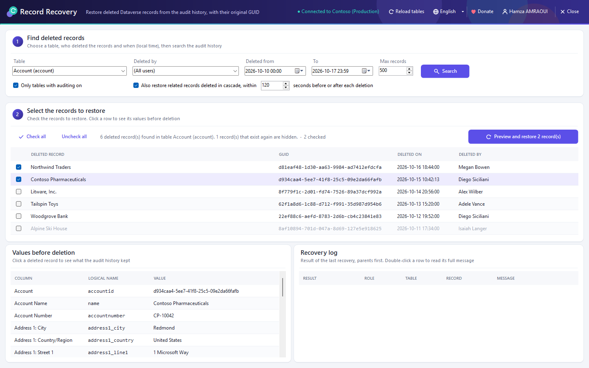
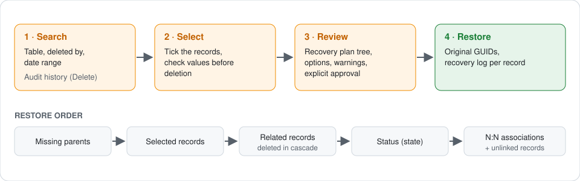
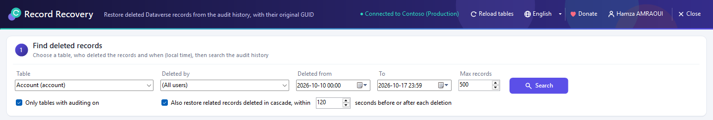
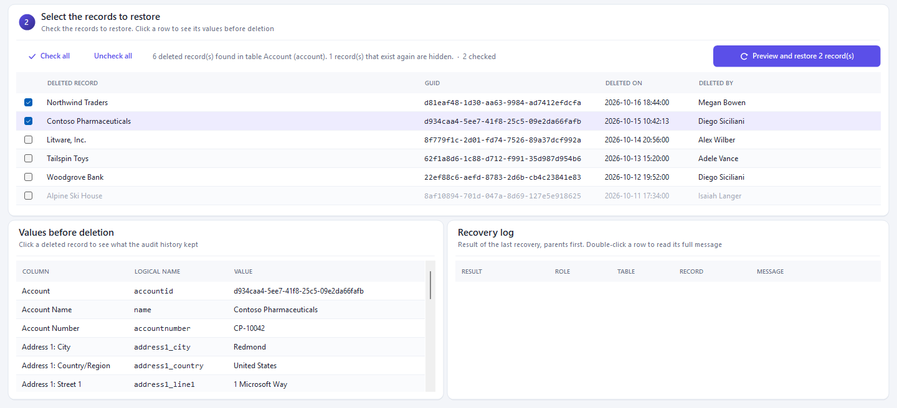
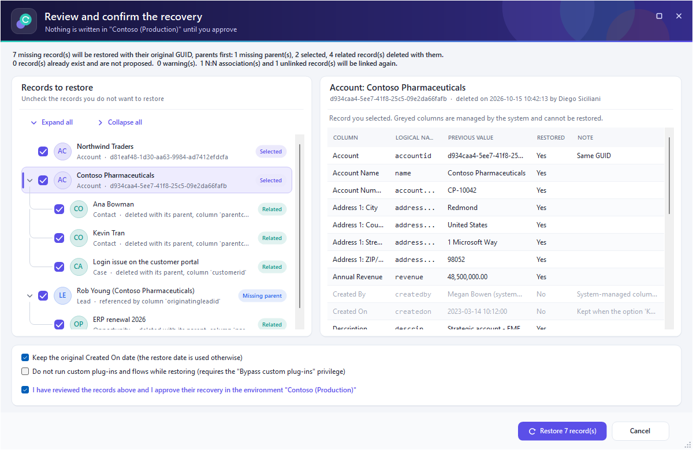
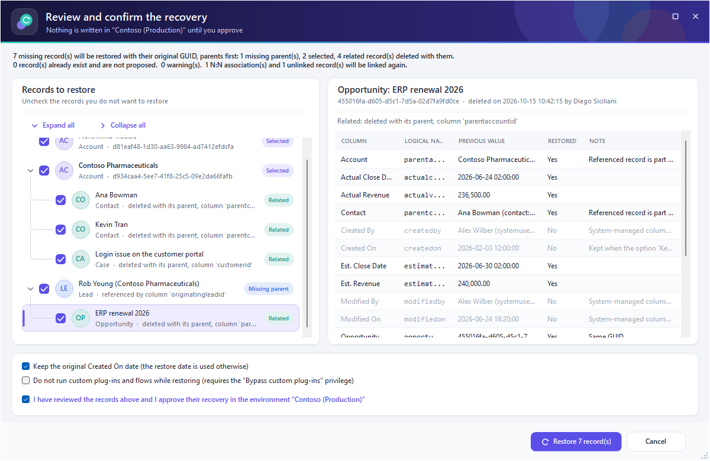
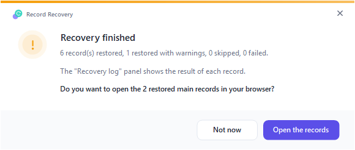
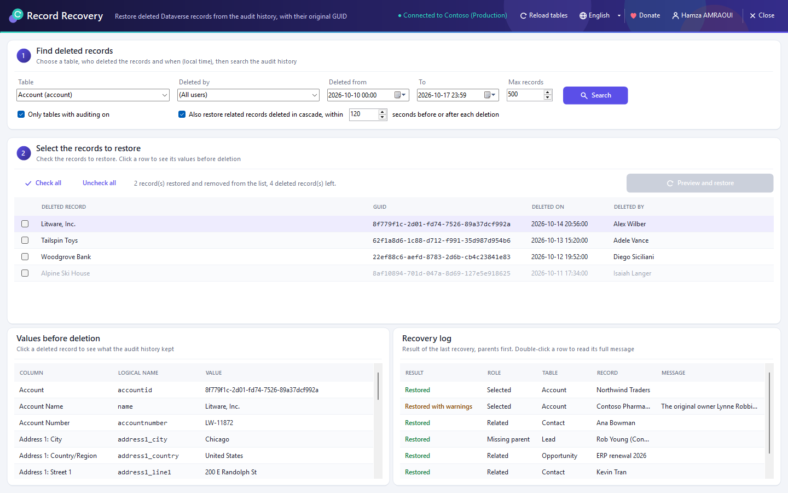

<p align="center">
  
</p>

<h1 align="center">Dataverse Record Recovery</h1>

<p align="center">
  An XrmToolBox tool that restores deleted Dynamics 365 / Dataverse records from the audit history —<br/>
  with their <b>original GUID</b>, their related records, their N:N associations and their status.
</p>

<p align="center">
  <a href="https://www.xrmtoolbox.com/"></a>
  
  <a href="https://mit-license.org/"></a>
</p>

---

Someone deleted the wrong account, and its contacts, opportunities and cases went with it? Dataverse has no recycle bin for most tables, but the **audit history** keeps the values each record had when it was deleted. Dataverse Record Recovery reads that history, shows you exactly what can be brought back, and recreates the records **with the same GUID**, so URLs, integrations and lookups that pointed to them work again.



<sub>Screenshots taken with sample data (fictitious Contoso environment).</sub>

## Features

- 🔎 **Search deleted records** by table, user who deleted them and date range.
- 👀 **Preview the values** each record had before its deletion.
- 🆔 **Restore with the original GUID**, the original owner and, optionally, the original *Created On* date.
- 🔗 **Bring back the whole picture**: related records deleted in cascade, deleted parent records, N:N associations, and records whose lookup was emptied by the deletion.
- 🚦 **Restore the status**: inactive records are deactivated again; cases and opportunities are closed with their dedicated messages.
- ✅ **Nothing is written before you approve** a full recovery plan, and records that already exist are never overwritten.
- 📋 **Recovery log** with the result of every record.
- 🌐 English and French interface.

## How a recovery works



## Prerequisites

| Requirement | Why |
| --- | --- |
| **Auditing enabled** on the organization **and** on the table *at the time of the deletion* | Only deletions recorded in the audit history can be found. |
| **View Audit History** and **View Audit Summary** privileges | To search the audit history. |
| **Create** privilege on each restored table | To recreate the records. |
| **Bypass custom plug-ins** privilege *(optional)* | Only if you want to skip custom plug-ins and flows during the restore. |

> [!TIP]
> If a privilege is missing, the tool tells you which one and what it is needed for.

## Installation

1. Open **XrmToolBox** and go to **Tool Library**.
2. Search for **Dataverse Record Recovery** and click **Install**.
3. Open the tool and connect to your environment.

## Step-by-step: recover deleted records

### Step 1 — Find the deleted records



1. Choose the **Table** whose records were deleted (for example *Account*).
   *Only tables with auditing on* is ticked by default — untick it to also see tables whose auditing has been turned off since.
2. Pick the user in **Deleted by**, or keep **(All users)**.
3. Set **Deleted from** and **To** (local time).
4. Adjust **Max records** if needed (500 by default).
5. Keep **Also restore related records deleted in cascade** ticked to bring back the child records deleted together with each record. The time window (120 seconds by default) is how far around each deletion the tool looks for them.
6. Click **Search**.

### Step 2 — Select the records to restore



1. The list shows every deleted record found, with its name, GUID, deletion date and the user who deleted it. Records that exist again are hidden automatically.
2. Click a row to see its **Values before deletion** in the right-hand panel.
3. Tick the records you want back (**Check all** / **Uncheck all** are available).
4. Click **Preview and restore**.

### Step 3 — Review and confirm the recovery plan



The tool builds the complete recovery plan and shows it as a tree, **parents first**:

| Role | Meaning |
| --- | --- |
| **Missing parent** | A deleted record referenced by a lookup of a record you selected. It is restored first so the lookup can be set. |
| **Selected** | A record you ticked in step 2. |
| **Related** | A child record deleted in cascade with a selected record. |
| **N:N association** / **Linked record** | Associations and lookups that will be put back once all records exist. |

1. Click a record to see its **Record details**: previous value, whether each column is restored, and a note explaining why when it is not (system column, column removed from the table…).

   

2. Uncheck any record you don't want to restore.
3. Read the warnings — for example a lookup that will stay empty because its target can no longer be found.
4. Choose the options:
   - **Keep the original Created On date** (otherwise the restore date is used).
   - **Do not run custom plug-ins and flows while restoring**.
5. Tick **I have reviewed the records above and I approve their recovery…** and click **Restore N record(s)**.

> [!IMPORTANT]
> Nothing is written to the environment before this approval. Records that already exist with the same GUID are left out of the plan and are never overwritten.

### Step 4 — Check the result

When the recovery is over, a summary tells you how many records were restored, restored with warnings, skipped or failed:





1. The **Recovery log** lists every record with its result: **Restored**, **Restored with warnings**, **Skipped** or **Failed**.
2. Double-click a row to read the full message.
3. The tool offers to open the restored records in your browser so you can check them.

Restored records are removed from the list in step 2; the others stay there if you want to try again.

## What gets restored — and what doesn't

| ✅ Restored | ⚠️ Not restored |
| --- | --- |
| Column values stored in the audit history | Values the audit history did not keep |
| Original GUID | System columns (*Modified On*, *Modified By*, …) — set by Dataverse |
| Original owner (when it can still own the record) | *Created On* — unless the option is ticked |
| Status and status reason (cases and opportunities closed properly) | Lookups to records that no longer exist and whose deletion cannot be found (left empty, with a warning) |
| N:N associations and records unlinked by the deletion | Records deleted while auditing was off |

## Build from source

```powershell
git clone https://github.com/AmraouiH/DataverseRecordRecovery.git
cd DataverseRecordRecovery
msbuild "Dataverse Record Recovery.sln" /restore /p:Configuration=Release
```

Copy `Dataverse Record Recovery\bin\Release\DataverseRecordRecovery.dll` to `%APPDATA%\MscrmTools\XrmToolBox\Plugins` and restart XrmToolBox.

### Project layout

| Folder | Content |
| --- | --- |
| `Dataverse Record Recovery/Services` | Audit history reading, recovery plan and restore engine, metadata cache. |
| `Dataverse Record Recovery/Models` | Deleted records, recovery plan and options. |
| `Dataverse Record Recovery/Forms` | Review dialog and themed dialogs. |
| `Dataverse Record Recovery/UI` | Theme, icons and custom controls. |
| `Dataverse Record Recovery/Localization` | English and French texts. |

## Support

Found a bug or have an idea? [Open an issue](https://github.com/AmraouiH/DataverseRecordRecovery/issues).
Developed by [Hamza AMRAOUI](https://www.linkedin.com/in/hamza-amraoui/) — if the tool saved your day, you can [support it on PayPal](https://www.paypal.com/paypalme/EntityFieldsAnalyser).

## License

[MIT](https://mit-license.org/)
